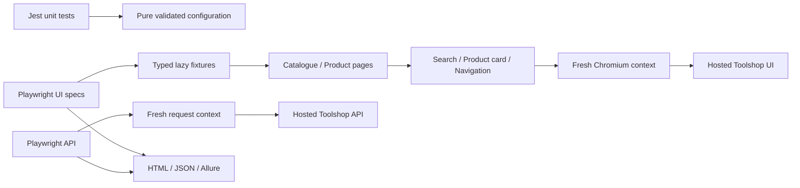

# SDET Automation Patterns Lab

A practical TypeScript automation framework demonstrating SDET design patterns, BDD,
data-driven testing, API/UI automation, SOLID principles, and CI/CD best practices.

This repository grows in verified increments against the real
[Toolshop practice application](https://practicesoftwaretesting.com/). Its first
milestone establishes an executable foundation; subsequent milestones introduce
patterns only when a working scenario needs them.

## Current milestone

**Phases 0–2: foundation and UI architecture.** Strict TypeScript, Playwright UI/API
projects, Jest unit tests, validated configuration, composed page/component objects,
lazy typed fixtures, linting/formatting, HTML/JSON/Allure reporting and persistent
project memory. The real smoke suite covers:

- A shopper searching for pliers and opening the selected product.
- Clearing an empty search to restore the browsable catalogue.
- Shared header navigation from product detail back to the catalogue.
- Catalogue listing followed by a current-ID detail read with consistent name/price.
- Nonempty search results matching the requested product name.
- Rejection of anonymous account-profile access.

The deterministic suite validates configuration defaults, deployment URL prefixes,
caller isolation, invalid URL settings and secret-safe error messages.

**Planned, not implemented:** API services, data factories/builders, DDT/KDT, Cucumber
business scenarios, controlled local API, parallel reliability checks and GitHub Actions. See the
[phased roadmap](docs/ROADMAP.md) and [current checkpoint](docs/PROGRESS.md).

## Install

Use Node.js **24 LTS**, npm **11**, and Git. No application credentials, Docker,
database, global packages or Java installation are needed.

```bash
git clone https://github.com/Kunonuk/sdet-automation-patterns-lab.git
cd sdet-automation-patterns-lab
nvm use # optional; .nvmrc selects major 24
npm ci
PLAYWRIGHT_SKIP_BROWSER_GC=1 npx playwright install chromium
```

On supported Linux CI hosts, use `npx playwright install --with-deps chromium` when
browser system libraries are absent. Dependencies are pinned and locked. TypeScript
6.0.3 is intentional: the current ESLint parser does not support TypeScript 7.
[Compatibility research](docs/RESEARCH.md) records the checked engines and peers.

## Execute

```bash
npm run verify          # deterministic: types, lint, format and Jest
npm test                # Jest only; never contacts Toolshop
npm run test:external   # all six real Toolshop scenarios
npm run test:api        # only the three API scenarios
npm run test:ui         # only the three Chromium UI scenarios
npm run typecheck
npm run lint
npm run format:check
```

Browsers run **headlessly**, with one worker and zero retries. Public smoke requires
Internet access and the public application's availability. It creates no accounts,
carts or orders. It reads current IDs instead of pinning ephemeral seed data. A
failure exits nonzero; it is never converted into a successful skip.

`npm run test:external -- --grep "anonymous caller"` targets a scenario.
`npm run test:external -- --list` lists discovered tests; discovery is not execution.
The current UI uses HTTP `QUERY` with a JSON body for search; API smoke separately
exercises the documented GET variant. The UI test observes that actual request.

An optional `.env` can override `TOOLSHOP_UI_BASE_URL` and `TOOLSHOP_API_BASE_URL`;
copy `.env.example` if needed. Missing `.env` uses public defaults. URL overrides
must be HTTP(S), without credentials, query or fragment; path prefixes are retained.
No secret values belong in tracked source. Overrides must point to an authorized
test environment with a compatible Toolshop UI/API contract.

## Architecture and reporting



Jest runs emitted JavaScript from strict TypeScript after cleaning its generated
directory; it needs no Babel, ts-jest or ts-node configuration. Playwright alone owns
UI/API scenarios and resource lifecycles. Future Cucumber workflows will have their
own runner and reuse runner-neutral abstractions.

CataloguePage and ProductPage compose focused widgets rather than inheriting from a
base page. Typed test-scoped fixtures inject the Page and shared navigation component;
this lazy construction graph demonstrates practical Page Factory concepts without a
separate registry. Specs own assertions and expose their business expectations:

```typescript
import { expect, test } from '../../src/core/fixtures/ui.fixture';

test('a selected card opens its own product detail', async ({ catalogue, product, page }) => {
  await catalogue.open();
  const selected = await catalogue.firstProduct.open();
  await expect(page).toHaveURL(selected.url);
  await expect(product.name).toHaveText(selected.name);
});
```

Page/component modules use Playwright types only and remain independent of runner
hooks. See
[architecture](docs/ARCHITECTURE.md), [decisions](docs/DECISIONS.md),
[patterns](docs/PATTERNS.md) and [test strategy](docs/TEST_STRATEGY.md).

```bash
npm run test:external
npm run report:allure
# Optional local report viewers (do not rerun the tests):
npx allure open allure-report
npm run report:html
```

Playwright writes `test-results/results.json` and `playwright-report/index.html`;
Allure writes `allure-results/` and `allure-report/index.html`. Allure includes
scenario tags, business steps and request/assertion details. Playwright configures
failure-only screenshots and retained failure traces. Phase 2 observed these
attachments in the expected red test and corrected locator failure; the final clean
report contains only the six passing executions.

Each external command clears previous Allure results; report generation cleans the
previous generated report. Use `test:external` to report UI and API together. All
generated artifacts, local environment files and dependencies are Git-ignored.
Review diagnostics for sensitive runtime data before sharing them.

## Quality gates and limitations

`npm run verify` is the current local quality gate and works without public demo
access after dependencies are installed. GitHub Actions is planned for Phase 7;
there are no CI badges or implied remote workflow results yet. An original minimal
local catalogue API in Phase 3 will support deterministic API gates. Hosted smoke
will remain a separate, explicitly failing external check.

The last recorded dependency audit reported **19 moderate findings**, all propagating
from one `sprintf-js` denial-of-service advisory in Jest's legacy configuration
dependency chain. No high/critical findings were reported. The published audit fix
requires an incompatible Jest downgrade. See [dependency risks](docs/DEPENDENCIES.md).
The test utilities and smoke scenarios have run locally; this does not establish a
complete Toolshop regression suite, browser matrix, performance profile or CI result.

Toolshop is a shared public environment with mutable catalogue data. Search smoke
expects at least one product whose name contains `pliers`; a catalogue policy change
can legitimately require updating that business expectation. Only Chromium is
installed/tested. API/data patterns, BDD and the remaining roadmap phases are future
milestones; Phase 2 does not claim broad parallel reliability verification.

## Continue the project

Read [PROGRESS](docs/PROGRESS.md), [ROADMAP](docs/ROADMAP.md),
[ARCHITECTURE](docs/ARCHITECTURE.md), [PATTERNS](docs/PATTERNS.md),
[DECISIONS](docs/DECISIONS.md) and [TEST_STRATEGY](docs/TEST_STRATEGY.md), then inspect
the code and Git state. Resume the next incomplete task. The
[foundation plan](docs/IMPLEMENTATION_PLAN.md) and [Phase 2 plan](docs/PHASE_2_PLAN.md)
preserve the implemented milestones' decisions. Phase 3 requires a new user request.
Keep changes small, run relevant checks, and update the checkpoint after milestones.

This project contains original automation only. Toolshop source, images, seed content
and its OpenAPI document are not redistributed. Review the
[upstream license](https://github.com/testsmith-io/practice-software-testing/blob/main/LICENSE)
before any source reuse, hosting or commercial use. Public GitHub visibility does not
itself grant a license to redistribute upstream software.
